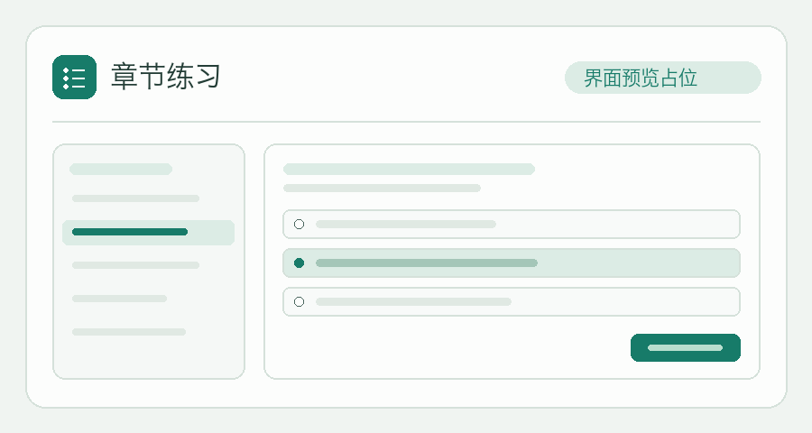
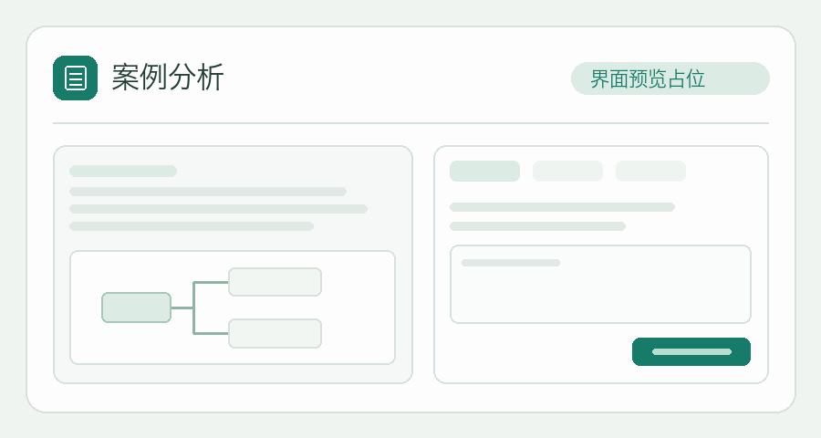

<h1 align="center">Linear 软考</h1>

专注软考高级「系统架构设计师」的极简免费刷题平台。

  

题库免费，练习页面无广告。打开网站即可免登录做章节选择题和每日练习，提交后查看解析。案例可先浏览，提交作答时需要登录。登录后可跨设备同步学习进度和错题。

[免费刷题，浏览已开放章节与案例](https://mentorai.top/)

## 练习方式

- **章节选择题**　按《系统架构设计师教程》第 2 版的章节目录练习。连续模式选完自动前进，逐题精讲在提交后展示核心解析。部分辨析题和图表题还提供选项排雷。
- **案例分析**　对照案例材料分小问作答，再核对每问的参考要点。
- **键盘作答**　电脑上可用数字键 `1`–`4` 选择相应选项，逐题精讲可用 `Enter` 提交或继续。做案例时可用 `⌘ + Enter` 或 `Ctrl + Enter` 核对参考要点。

## 已开放内容

截至 2026 年 11 月 26 日，站内开放 **第 1–7 章的 1,140 道选择题和 3 道案例**。

| 章节 | 练习范围 |
| --- | --- |
| 第 1 章 | 绪论 |
| 第 2 章 | 计算机系统基础知识 |
| 第 3 章 | 信息系统基础知识 |
| 第 4 章 | 信息安全技术基础知识 |
| 第 5 章 | 软件工程基础知识 |
| 第 6 章 | 数据库设计基础知识 |
| 第 7 章 | 系统架构设计基础知识 |
| 案例专项 | 质量属性分析、Redis 哨兵与缓存基础、面向对象基础 |

先按章做一轮，再用逐题精讲复盘判断依据。练到架构设计时，可搭配质量属性案例，练习把判断写成分点答案。

| 近期题库更新 | 内容 |
| --- | --- |
| 2026-11-26 | 开放第 7 章 124 道选择题，覆盖架构风格、复用与特定领域软件体系结构。 |
| 2026-11-26 | 优化第 4 章 98 道选择题的解析，基础题提炼考点，辨析题补充选项判断依据。 |

## 界面预览

| 章节练习 | 案例分析 |
| --- | --- |
|  |  |

## 反馈与更新

- 发现题目、答案或解析有问题，可在站内练习页点击 **题目纠错**，反馈会自动带上题号和题版。
- 遇到访问、登录或使用问题，可在网站的账号设置中选择 **联系站长**。
- 新增章节和功能可在网站顶部的 **更新日志** 查看。
